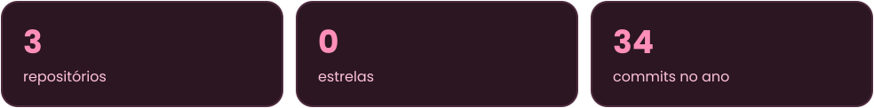
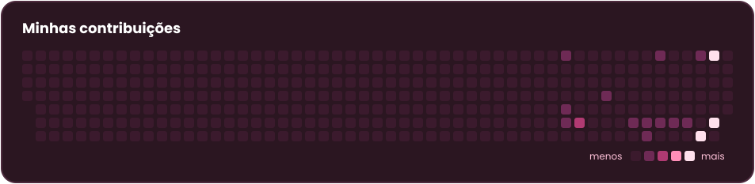

## 🌸 Sobre mim

Estudante de Engenharia de Software, aprendendo Java e lógica de programação. Gosto de aprender na prática e de evoluir um commit de cada vez.

## 🐱 Minhas ferramentas

## 💗 Meus números

## Minhas contribuições

## 📬 Contato

  

